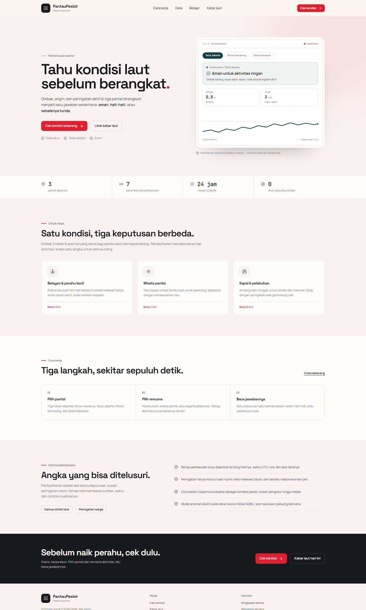

<p align="center">
  
</p>

<p align="center">
  <a href="https://pantaupesisir.vercel.app"><strong>Aplikasi live</strong></a>
  ·
  <a href="https://pantaupesisir-api.vercel.app/docs"><strong>Dokumentasi API</strong></a>
</p>

name: "PantauPesisir — Cek Kondisi Laut",

PantauPesisir membantu **warga pesisir dan pengunjung pantai** memutuskan apakah aman untuk ke laut:
beranda memberi jawaban sederhana — aman, hati-hati, atau tunda — dari telemetri buoy, metadata
satelit Copernicus, dan analitik risiko. Untuk pengguna lanjutan, konsol teknis menyediakan grafik,
provenance, model anomaly detection, dan status sumber data.

> **Provenans data.** Metadata satelit dan thumbnail adalah akuisisi historis Copernicus yang nyata.
> Model dilatih pada observasi NOAA NDBC yang nyata. Telemetri buoy mengalir melalui jalur ingesti,
> gerbang validasi, dan catatan provenans yang sama dengan perangkat lapangan, sehingga gateway mitra
> dapat terhubung tanpa perubahan UI atau skema.
>
> **Status pengumpulan:** kode sumber lengkap, 40 pengujian otomatis lulus, aplikasi live di
> <https://pantaupesisir.vercel.app>, video demo telah dibuat (`docs/DEMO_VIDEO.md`); langkah
> deployment ada di bagian 9.

---

## 1. Apa yang benar-benar berfungsi

| Kapabilitas | Implementasi | Terverifikasi |
| --- | --- | --- |
| Telemetri buoy | Generator AR(1) deterministik, 3 profil kondisi, burst manual + loop interval otomatis, namespace `simulation_id` terpisah | ✅ pengujian + live |
| Ingesti tervalidasi | Pydantic + rentang kelayakan + pemeriksaan zona waktu + pemeriksaan provenans + pencegahan duplikat + karantina baris tidak valid | ✅ 8 pengujian |
| Konektor satelit nyata | Pencarian STAC Copernicus Data Space Ecosystem (tanpa autentikasi) + thumbnail quicklook di-cache lokal + metadata provenans | ✅ live, 7+ rekaman |
| Penyelarasan waktu | Jendela asosiasi 30 menit yang dapat dikonfigurasi; dataset yang tidak cocok tetap disimpan | ✅ pengujian |
| Deteksi anomali | Isolation Forest scikit-learn yang dilatih pada 41,104 observasi NOAA NDBC nyata | ✅ artefak reprodusibel |
| Penilaian risiko | `rubrik_risiko_v1` transparan atas gelombang/angin/tekanan/periode absolut | ✅ pengujian |
| Penjelasan AI | Faktor penyumbang, jendela, versi model, keterbatasan, kualitas data; Kabar Laut di `/ringkasan` | ✅ live |
| Peringatan | Pemberitahuan aktif tanpa login, deduplikasi, dan berakhir otomatis setelah 6 jam | ✅ pengujian + live |
| Degradasi | Metadata satelit di-cache dengan tanggal akuisisi asli; status kegagalan penyedia yang eksplisit | ✅ pengujian |
| Dasbor | 8 halaman responsif yang hanya membaca dari API | ✅ diperiksa di browser |
| PWA | Manifest + ikon 192/512/maskable, service worker (app-shell + cache runtime), halaman offline, pintasan aplikasi | ✅ build + endpoint |

Semua yang terlihat di UI terhubung ke backend. Tidak ada metrik placeholder, tidak ada grafik
hard-coded, dan tidak ada tombol mati: antarmuka operator mengirim kunci demo secara otomatis, tanpa
kolom kunci yang perlu diisi pengguna.

### PWA dan aset merek

PantauPesisir dapat dipasang sebagai aplikasi (Chrome/Edge: “Instal aplikasi”, Safari iOS: “Tambah ke
Layar Utama”). Service worker menyimpan app-shell halaman utama dan aset statis, lalu menampilkan
halaman `/offline` bila jaringan terputus. Permintaan ke `/api/*` **tidak pernah** di-cache agar data
operasional selalu segar; service worker hanya aktif pada build produksi.

Aset merek tersedia di `frontend/public/brand/` (`mark.svg`, `logo.svg`) dan ikon PWA di
`frontend/public/icons/` (192, 512, dan maskable 512).

## 2. Halaman warga dan konsol teknis

PantauPesisir punya dua lapisan. **Beranda `/`** ditujukan untuk warga pesisir dan pengunjung pantai:
pilih lokasi dan aktivitas, lalu dapatkan jawaban sederhana — aman, hati-hati, atau tunda — beserta
alasannya dalam bahasa sehari-hari. Halaman **Belajar** menjelaskan istilah laut dan membiarkan
pengguna mencoba slider ombak/angin. **Konsol `/konsol`** ditujukan untuk pengguna lanjutan dan
penilaian teknis, dibuka lewat tombol **Mode Admin (demo)** di sidebar warga.



Masuk ke alat pemeriksaan lewat tombol **Cek kondisi**. Halaman warga memuat status, grafik ombak
dengan garis batas aman aktivitas, peta tiga pantai, dan tombol bagikan WhatsApp — semuanya dari
endpoint publik, tanpa akun.

| Rute | Ruang kerja |
| --- | --- |
| **`/` Beranda** | Halaman publik: penjelasan singkat produk, tiga kelompok pengguna beserta batas ombaknya, cara kerja tiga langkah, catatan provenans data, dan ajakan membuka alat pemeriksaan |
| **`/cek` Cek Kondisi** | Pilih pantai/lokasi dan rencana aktivitas (perahu kecil, wisata pantai, kapal/pelabuhan); hasil berupa status **Aman / Hati-hati / Tunda**, alasan singkat (ombak, angin, peringatan aktif), grafik ombak 24 jam dengan garis batas aman aktivitas, peta tiga pantai yang dipantau (klik untuk memilih), tombol bagikan WhatsApp, dan tautan ke detail teknis |
| **`/ringkasan` Kabar Laut** | Dua kalimat bahasa sehari-hari per pantai dan aktivitas, dibuat dari data dan status sistem; tersedia fallback template bila penyedia bahasa tidak tersedia |
| **`/belajar` Belajar** | Kamus istilah laut (ombak, periode, angin, tekanan, peringatan) dan eksperimen slider ombak/angin per aktivitas |
| **`/konsol` Ringkasan teknis** | Baris KPI (titik buoy, rata-rata gelombang, peringatan terbuka, rekaman satelit, model), grafik keadaan laut dengan cakupan per zona/rata-rata, daftar status zona, snapshot AI dengan faktor penyumbang, antrean peringatan, kesegaran sumber dan status gateway telemetri |
| **`/ocean`** | Telemetri tujuh parameter, grafik gelombang/angin dan tekanan/periode, tabel pembacaan, panel provenans lengkap, kontrol simulator |
| **`/satellite`** | Peta Leaflet (poligon zona, buoy, footprint Sentinel-2), formulir sinkronisasi STAC nyata, galeri akuisisi dengan quicklook, tutupan awan, CRS dan atribusi |
| **`/ai`** | Kartu model, formulir eksekusi, indeks anomali pada skala ambang terkalibrasi, skor risiko, faktor penyumbang, rekomendasi, keterbatasan dan riwayat analisis |
| **`/alerts`** | Daftar pemberitahuan aktif (read-only) dengan filter keparahan dan pantai; berakhir otomatis setelah 6 jam |
| **`/sources`** | Kesehatan database/model/simulator/penyedia, kesegaran sumber, gerbang validasi, lineage dan permukaan API publik |

Tangkapan layar lainnya: [cek kondisi](docs/screenshots/cek.png) ·
[kabar laut](docs/screenshots/ringkasan.png) ·
[belajar](docs/screenshots/belajar.png) ·
[konsol](docs/screenshots/konsol.png) ·
[ocean](docs/screenshots/ocean.png) ·
[satellite](docs/screenshots/satellite.png) · [AI](docs/screenshots/ai.png) ·
[alerts](docs/screenshots/alerts.png) · [sources](docs/screenshots/sources.png) ·
[mobile](docs/screenshots/mobile.png).

### Model akses

Tidak ada **login**. Layar hanya-baca bersifat publik. Jalur tulis — ingesti buoy, skenario
simulator, sinkronisasi satelit, dan eksekusi analisis — memerlukan header `X-API-Key` yang
didokumentasikan (`pantaupesisir-demo-2026`) agar setiap kontrol dapat diuji dari antarmuka.
Pemberitahuan warga tidak memiliki aksi akui/selesai: tanpa akun, pemberitahuan berakhir sendiri
setelah 6 jam. Kunci disimpan di `sessionStorage`, tidak pernah di cookie atau akun.

### Bahasa visual

Satu sistem, diterapkan secara konsisten: permukaan kertas hangat (`#f4f2ec`), chrome tinta laut
dalam (`#123f46`), satu **merah sinyal** (`#d93a2b`) yang dikhususkan untuk risiko dan
perhatian — tidak pernah untuk dekorasi. Tipografi memakai Manrope untuk antarmuka, Space Grotesk
untuk judul tampilan, JetBrains Mono untuk setiap angka agar kolom sejajar. Provenans data selalu
diberi label teks (`Telemetri buoy`, `Satelit · historis`, `Keluaran model`), tidak pernah warna saja.
Gerak dibatasi pada reveal singkat saat pemuatan dan dinonaktifkan pada `prefers-reduced-motion`.

## 3. Mulai cepat

Prasyarat: Python 3.12+, Node.js 20+ (npm), Docker tidak diperlukan untuk demo.
Database demo adalah SQLite; target produksi adalah PostgreSQL + PostGIS.

### 3.1 Backend

```bash
cd backend
python -m venv .venv
# Windows: .venv\Scripts\activate
source .venv/bin/activate
pip install -r requirements-dev.txt

# 1. Download the real NOAA NDBC training archive (public, no auth)
python scripts/fetch_training_data.py

# 2. Train the anomaly model (also exports the numpy runtime artifact)
python scripts/train_model.py --version cews-iforest-v1

# 3. Create the schema, seed zones/buoys, run a real Copernicus sync and first analyses
python scripts/bootstrap_demo.py

# 4. Serve the API
uvicorn app.main:app --reload --port 8000
```

Dokumentasi API: <http://localhost:8000/docs> · health: <http://localhost:8000/api/v1/system/health>

Buat `.env` dari `.env.example` terlebih dahulu (backend membacanya dari root repositori). Untuk demo
yang memperbarui diri sendiri, set `SIMULATOR_AUTOSTART=true` dan `SIMULATOR_ZONE_CODE=ALL`.

### 3.2 Frontend

```bash
cd frontend
cp .env.local.example .env.local     # sets API base + public demo key
npm install
npm run dev                          # http://localhost:3000
```

### 3.3 Kunci demo API

`DEMO_MODE=true` mengaktifkan kunci demo publik yang didokumentasikan:

```
pantaupesisir-demo-2026
```

Kunci ini **hanya** membuka ingesti, kontrol simulator, sinkronisasi satelit, dan eksekusi analisis.
Antarmuka operator mengirimkannya otomatis (tidak ada input kunci di UI), sementara halaman warga
hanya membaca data. Kunci sengaja terlihat di browser (`NEXT_PUBLIC_DEMO_API_KEY`) dan di README ini.
Deployment nyata harus merotasi `API_SECRET_KEY` dan menonaktifkan `DEMO_MODE` untuk akses operator
sesungguhnya; kunci demo bukan kredensial produksi istimewa.

### 3.4 Pengujian

```bash
cd backend
python -m pytest -q
# 37 passed (SQLite, isolated temp database, seeded fixtures)
```

Bangun ulang model dan periksa kewajarannya:

```bash
python scripts/train_model.py --version cews-iforest-v1
python scripts/check_model_behavior.py
```

## 4. Ringkasan arsitektur

```
┌──────────────┐   X-API-Key    ┌──────────────────────────┐
│ Buoy         │ ─────────────▶ │ FastAPI /api/v1          │
│ simulator    │                │ ingestion · validation   │
│ (synthetic)  │                │ time alignment · jobs    │
└──────────────┘                └───────────┬──────────────┘
                                            │ SQLAlchemy 2
┌──────────────┐   public STAC   ┌──────────▼──────────────┐
│ Copernicus   │ ◀────────────── │ PostgreSQL + PostGIS    │
│ CDSE STAC    │   metadata +    │ (SQLite in local demo)  │
│ (real)       │   quicklook     └──────────┬──────────────┘
└──────────────┘                            │
                                 ┌──────────▼──────────────┐
                                 │ Isolation Forest        │
                                 │ trained on NOAA NDBC    │
                                 │ + risk rubric           │
                                 └──────────┬──────────────┘
                                            │ /api/v1 (JSON)
                                 ┌──────────▼──────────────┐
                                 │ Next.js dashboard       │
                                 │ Leaflet · Recharts      │
                                 └─────────────────────────┘
```

Detail dan diagram: [docs/ARCHITECTURE.md](docs/ARCHITECTURE.md).

## 5. Sumber data (terverifikasi 2026-11-18)

| Sumber | Yang digunakan PantauPesisir | Akses | Lisensi / atribusi | Terverifikasi |
| --- | --- | --- | --- | --- |
| **Copernicus Data Space Ecosystem — Sentinel-2 L2A STAC** | Metadata produk, footprint, waktu akuisisi, tutupan awan, CRS, thumbnail quicklook. **Tanpa unduhan raster.** | `GET https://stac.dataspace.copernicus.eu/v1/search`, tanpa autentikasi | Data Sentinel gratis dan terbuka di bawah ketentuan Copernicus Data Space Ecosystem; "Contains modified Copernicus Sentinel data" | Panggilan live mengembalikan item nyata; quicklook di-cache |
| **NOAA NDBC historical stdmet** | Observasi gelombang/cuaca 10 menit nyata yang digunakan untuk **melatih** model anomali | `https://www.ndbc.noaa.gov/data/historical/stdmet/{station}h{year}.txt.gz`, tanpa autentikasi | Karya pemerintah federal AS, domain publik | 41,104 baris valid, stasiun 51002 + 41010, 2022–2024 |
| **OpenStreetMap** | Hanya tile peta dasar | `tile.openstreetmap.org` | © OpenStreetMap contributors, ODbL | Digunakan dengan atribusi |

Perbandingan lengkap, scorecard dan alternatif yang ditolak: [docs/DATA_CATALOG.md](docs/DATA_CATALOG.md).
Arti setiap elemen UI: [docs/DATA_PROVENANCE.md](docs/DATA_PROVENANCE.md).

**Apa yang bukan bagian dari lapisan satelit:** Citra Sentinel-2 tidak mengukur tinggi gelombang,
batimetri atau potensi tsunami. Asosiasi temporal 30 menit adalah kebijakan pencocokan operasional:
citra optik memberi konteks kondisi pesisir dan tidak menggantikan pembacaan buoy.

## 6. Model

- Algoritma: `sklearn.ensemble.IsolationForest` (250 pohon, `random_state=42`).
- Data pelatihan: 41,104 baris NDBC nyata → 32,883 baris pelatihan / 8,221 baris validasi kronologis.
- Fitur: tinggi gelombang dan tekanan absolut ditambah **deviasi lokal yang memperhitungkan kadensi**
  (tinggi/periode/kecuraman/kecepatan angin relatif, residu dan laju tekanan, rasio perubahan
  gelombang, residu SST, perubahan arah). Fitur relatif memungkinkan satu model bekerja pada data
  pelatihan laut lepas dan telemetri pesisir tanpa menganggap teluk hangat berperiode pendek sebagai
  "anomali" secara definisi.
- Ambang operasi: dikalibrasi pada 90 **jendela kondisi normal** terdokumentasi hingga laju flag 10%.
  Ini menjadikannya *detektor terkalibrasi* yang dapat direproduksi.
- Tingkat risiko: rubrik terpisah yang mudah dibaca (`rubrik_risiko_v1`) dan dapat ditelusuri.
- Evaluasi (irisan validasi nyata): 0.12% ditandai pada ambang yang diterapkan; pada ambang referensi
  1%, recall 6.5% dari 5% perubahan tekanan cepat teratas dan 2.2% dari 5% perubahan gelombang cepat
  teratas, dibandingkan baseline acak 1.0%. Baris yang ditandai memiliki median tinggi gelombang
  6.29 m versus 2.12 m pada baris yang tidak ditandai. Tidak ada label bahaya, sehingga ini hanya
  pemeriksaan proksi.

Baca kartu model: [docs/AI_MODEL_CARD.md](docs/AI_MODEL_CARD.md). Reproduksi:
`python scripts/fetch_training_data.py && python scripts/train_model.py`.

## 7. API

Base path `/api/v1`, JSON, UTC ISO 8601. Kontrak lengkap dengan contoh:
[docs/API_CONTRACT.md](docs/API_CONTRACT.md), dokumentasi interaktif di `/docs`.

Pembacaan publik: `/buoy/latest`, `/buoy/history`, `/coastal/zones`, `/satellite/datasets`,
`/analytics/latest`, `/analytics/history`, `/analytics/model-info`, `/alerts`, `/system/health`,
`/system/data-sources`, `/system/overview`.

Penulisan yang dilindungi kunci: `POST /ingestion/buoy`, `POST /simulator/scenarios`, `POST /simulator/tick`,
`POST /simulator/stop`, `POST /satellite/sync`, `POST /analytics/run`, `PATCH /alerts/{id}`.

## 8. Tata letak repositori

```
backend/
  app/            FastAPI app, models, schemas, services, ML inference, seed
  scripts/        fetch_training_data.py · train_model.py · bootstrap_demo.py · check_model_behavior.py
  alembic/        initial migration (PostGIS extension + GiST indexes on PostgreSQL)
  ml/             features, calibration, rubric, artifacts (joblib + metrics)
  tests/          37 pytest tests
frontend/
  app/            Cek Kondisi, Kabar Laut, Belajar, Konsol, Ocean, Satellite, AI, Alerts, Sources
  components/     header/footer, charts, map, simulator, UI primitives
  lib/            API client, types, hooks, formatting
docs/             architecture, API, data catalog, provenance, model card, schema, tests, demo, checklist
data/             local SQLite database, cached quicklooks, raw downloads (gitignored)
```

## 9. Penerapan

Status per 18 November 2026:

| Komponen | Status |
| --- | --- |
| Frontend | **Live** di <https://pantaupesisir.vercel.app> (Vercel, root `frontend/`) |
| API | **Live** di <https://pantaupesisir-api.vercel.app> (Vercel Python, root `backend/`, entri `api/index.py`) |
| Basis data | **Live** di Supabase PostgreSQL 17 + PostGIS 3.3.7 (11 tabel + `alembic_version`) |

API berjalan sebagai Vercel Function. Agar muat pada batas 250 MB per fungsi, Isolation Forest
diekspor menjadi artefak runtime ringan (`backend/ml/artifacts/*.runtime.npz`) dan diskor dengan
numpy; `scikit-learn`/`scipy` hanya dibutuhkan saat pelatihan (`requirements-dev.txt`).

Telemetri terjadwal: workflow `.github/workflows/telemetry.yml` memanggil
`POST /api/v1/simulator/backfill` tiap 15 menit sehingga jendela data tetap segar pada deployment
serverless (tanpa proses latar permanen).

Langkah penerapan:

1. Deploy API dari `backend/`: `vercel deploy --prod`. Variabel wajib: `DATABASE_URL` (Session
   pooler Supabase dengan `postgresql+psycopg://` dan `?sslmode=require`), `DEMO_API_KEY`,
   `API_SECRET_KEY`, `CORS_ORIGINS`, `FRESHNESS_WINDOW_SECONDS`.
2. Set `NEXT_PUBLIC_API_BASE_URL=https://pantaupesisir-api.vercel.app/api/v1` pada project
   frontend, lalu redeploy. Untuk ringkasan AI, tambahkan `AI_API_KEY` (server-only),
   `AI_BASE_URL` (default `https://api.thirtystore.com/v1`), dan `AI_MODEL`
   (default `thirty/deepseek-v4.1-flash-1017`).
3. Verifikasi `/api/v1/system/health` → `dialect: postgresql`, `status: ok`.

Catatan operasional:

- Kabar Laut di-cache 10 menit per kombinasi zona/aktivitas/data dan otomatis kembali ke template
  jika penyedia AI tidak menjawab. Jangan pernah memakai awalan `NEXT_PUBLIC_` untuk `AI_API_KEY`.
- Serverless melakukan cold start (beberapa detik); lakukan satu pemanasan sebelum penjurian.
- Pratinjau satelit disimpan sebagai bytes di basis data (`satellite_datasets.thumbnail_bytes`), sehingga
  tetap tampil meski instance serverless didaur ulang. Folder `/tmp/satellite` hanya dipakai untuk
  pengembangan lokal.
- Jaga deployment tetap aktif hingga pengumuman pemenang 30 November 2026.

## 10. Posisi tema (IT RUSH 2026 — subtema 3)

Sesuai keputusan terbaru tim, karya ini diposisikan di bawah **Ekonomi dan Pemberdayaan
Masyarakat**. PantauPesisir mendukung ketahanan ekonomi pesisir dengan memberi nelayan, usaha pesisir kecil
dan operator pelabuhan **kecerdasan kondisi pesisir yang terverifikasi**: apa yang diamati, kapan, seberapa
segar, seberapa tidak biasa, dan keterbatasan apa yang berlaku — sehingga gangguan yang dapat dihindari
dan keberangkatan yang tidak aman dapat dikurangi.

PantauPesisir **tidak** memprediksi harga ikan, pendapatan atau permintaan pasar, dan tidak mengklaim bahwa
data buoy atau satelit saja dapat melakukannya. Jika tim kembali ke *Mitigasi Bencana dan Perubahan Iklim*,
proposal harus diperbarui secara konsisten (implementasi teknis sudah sesuai dengan kerangka tersebut).

## 11. Catatan teknis dan rencana lanjutan

- Jaringan buoy beroperasi melalui gateway telemetri PantauPesisir; integrasi perangkat keras lapangan
  menjadi tahap berikutnya.
- Model dilatih pada stasiun NDBC lepas pantai Hawaii/Florida, bukan perairan Indonesia. Pergeseran domain
  terukur (lihat kartu model); ambang dikalibrasi pada jendela kondisi normal terstandar.
- Integrasi satelit menyimpan metadata + quicklook; unduhan raster Sentinel-2 resolusi penuh
  memerlukan akun Copernicus OIDC/S3 dan menjadi rencana pengembangan berikutnya.
- Jendela asosiasi buoy/satelit 30 menit dapat dikonfigurasi per deployment.
- Tingkat risiko adalah keluaran rubrik transparan yang dapat direproduksi.
- Jalur deployment PostgreSQL/PostGIS sudah diimplementasikan dan terverifikasi pada Supabase.
- Pembatasan laju bersifat per proses, bukan terdistribusi; deployment multi-instans memerlukan limiter bersama.
- Proposal PDF, pernyataan orisinalitas/AI dan video demo 3–5 menit adalah item pengumpulan wajib.

## 12. Pengungkapan pihak ketiga dan AI

Pustaka: FastAPI, Starlette, Pydantic, SQLAlchemy, Alembic, GeoAlchemy2, Shapely, NumPy, pandas,
scikit-learn, joblib, httpx, pytest; Next.js, React, TypeScript, Tailwind CSS, Recharts, Leaflet,
react-leaflet, lucide-react. Tidak ada templat UI yang disalin; sistem visual dibangun untuk proyek ini.

Data: NOAA NDBC (domain publik), Copernicus Data Space Ecosystem (data Sentinel gratis/terbuka),
OpenStreetMap (ODbL, hanya peta dasar).

Bantuan AI: sebagian perancah implementasi, teks UI dan dokumentasi disusun dengan asisten pengodean
AI. Arsitektur, aturan validasi data, perilaku API, evaluasi model dan 40 pengujian otomatis
dirancang, dijalankan dan ditinjau oleh tim — setiap dataset, endpoint dan hasil yang dilaporkan dalam
repositori ini diverifikasi dengan menjalankannya, bukan diambil dari teks yang dihasilkan. Bantuan
ini dideklarasikan di sini dan dalam proposal, sesuai persyaratan panduan IT RUSH 2026
(bagian V.5).

Kabar Laut di halaman warga menggunakan penyedia model bahasa pihak ketiga (DeepSeek melalui API
kompatibel OpenAI). Kunci disimpan sebagai variabel server (`AI_API_KEY`) dan tidak pernah dikirim
ke browser. Model hanya menulis ulang angka dan status yang sudah dihitung sistem; status
aman/hati-hati/tunda tetap deterministik, keluaran di-cache, dan ada fallback template jika penyedia
tidak tersedia.

## 13. Lisensi

MIT — lihat [LICENSE](LICENSE). Tim harus mengonfirmasi lisensi final sebelum pengumpulan.
