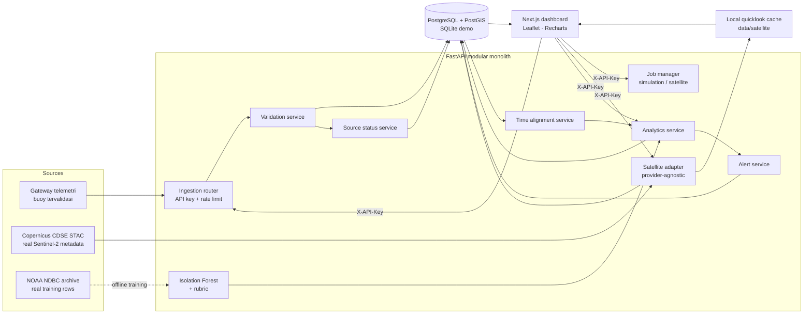
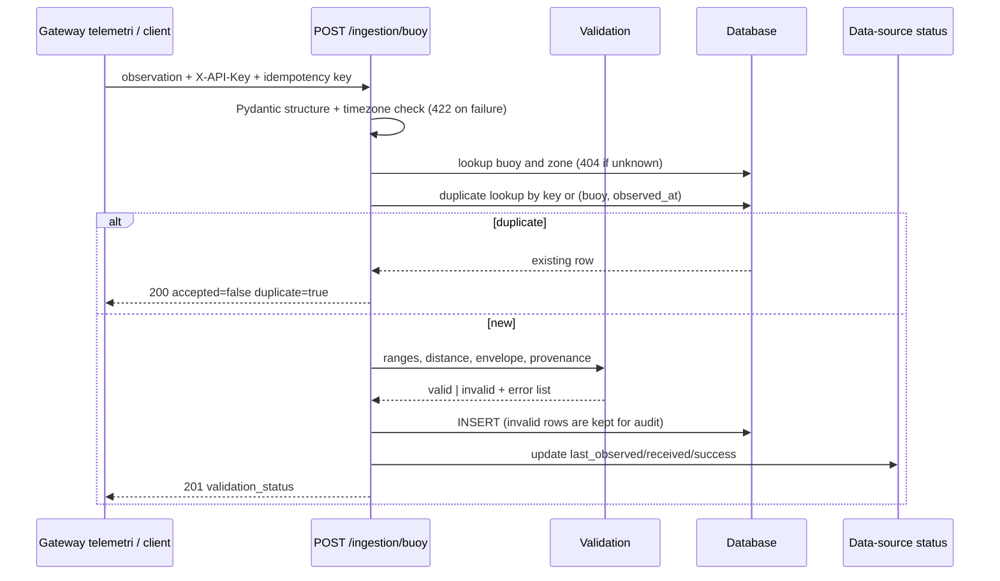
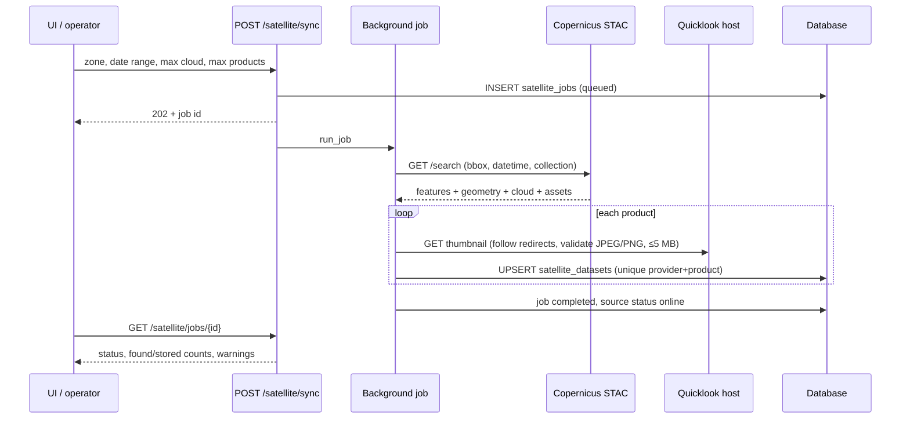
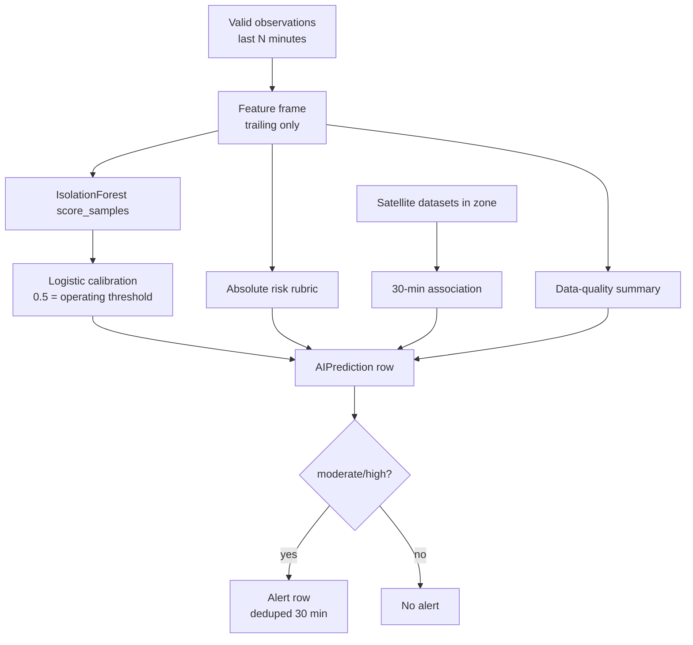
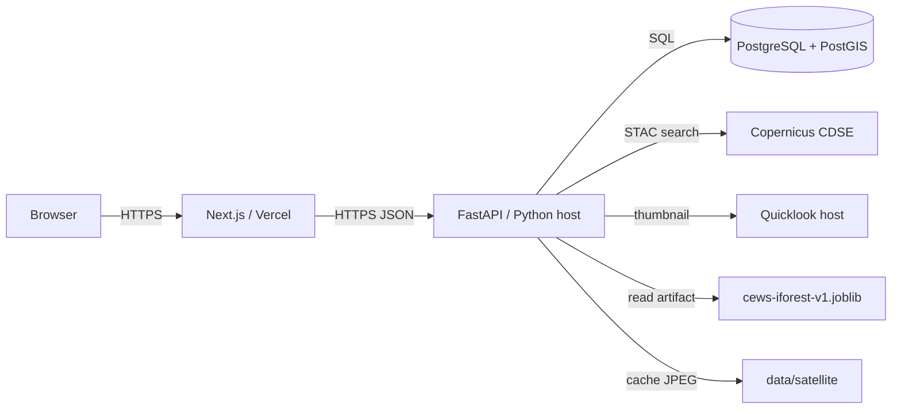

# Arsitektur

PantauPesisir adalah monolit modular: satu backend FastAPI, satu frontend Next.js, satu basis data
relasional (PostgreSQL/PostGIS di produksi, SQLite untuk demo) dan satu artefak model. Tidak ada
mikroservis.

## 1. Komponen

### Lapisan

| Lapisan | Modul | Tanggung jawab |
| --- | --- | --- |
| Sumber | `app/services/simulator.py` | Deret telemetri yang koheren, profil kondisi, mode batch + interval, seed deterministik |
| Sumber | `app/services/satellite/` | Protokol penyedia, adapter Copernicus STAC, caching thumbnail, fallback |
| Integrasi | `app/services/ingestion.py` | Jalur ingesti tunggal yang dipakai oleh API, gateway telemetri, dan seed |
| Integrasi | `app/services/validation.py` | Kewajaran, zona waktu, posisi, provenans, duplikat |
| Integrasi | `app/services/time_sync.py` | Asosiasi 30 menit, ringkasan kualitas |
| Analitik | `app/ml/` | Fitur, kalibrasi, ambang, penilaian skor, rubrik |
| Analitik | `app/services/analytics.py` | Pemilihan jendela, persistensi, penjelasan, pembuatan peringatan |
| Aplikasi | `app/api/v1/routers/` | Pembacaan publik, penulisan berhak istimewa, OpenAPI |
| Aplikasi | `frontend/` | Shell aplikasi dasbor (sidebar, bilah status) + enam ruang kerja yang membaca dari API |

## 2. Urutan ingesti

## 3. Akuisisi satelit

Jika penyedia tidak tersedia, job berakhir `completed_with_fallback`, sumber menjadi `unavailable`
dan dataset yang di-cache tetap terlihat tanpa perubahan. Pemantauan buoy dan analitik tidak
bergantung pada ketersediaan satelit.

## 4. Analisis AI

## 5. Keputusan desain utama

1. **Provenans di dalam skema, bukan di prosa.** `source_type`, `validation_status`,
   `validation_errors`, `simulation_id`, `idempotency_key`, timestamp akuisisi dan atribusi
   disimpan per baris dan ditampilkan di UI.
2. **Jam yang terpisah.** `observed_at`, `received_at`, `processed_at` tidak pernah dicampur.
3. **Tidak valid ≠ dihapus.** Baris di luar rentang disimpan dengan `validation_status="invalid"` dan
   dikecualikan dari grafik/analitik.
4. **Fitur yang sadar irama.** Model harus bertransfer dari irama NDBC 10 menit ke telemetri
   1–10 menit. Deviasi relatif dan laju per jam menggantikan statistik sampel-ke-sampel mentah.
5. **Kalibrasi bersifat eksplisit.** Ambang operasional di-fit pada jendela skenario normal yang
   terdokumentasi; metadata kalibrasi menyertai artefak dan ditampilkan di UI.
6. **Model ≠ risiko.** Skor anomali mengukur perilaku yang tidak biasa; rubrik menilai tingkat
   keparahan absolut. Keduanya dapat diperiksa secara independen.
7. **Geometri yang sadar dialek.** `app/db/types.py` menyimpan geometri Shapely sebagai PostGIS
   POINT/POLYGON/MULTIPOLYGON pada PostgreSQL dan teks WKT pada SQLite, sehingga satu lapisan model
   melayani keduanya.
8. **Fail closed pada penulisan.** Endpoint berhak istimewa mewajibkan `X-API-Key`; jika tidak ada
   key yang dikonfigurasi, API mengembalikan 503 alih-alih mengizinkan penulisan anonim.
9. **Panggilan penyedia yang terbatas.** Timeout, batas ukuran respons, pemeriksaan content-type dan
   jenis error eksplisit (`timeout`, `network`, `http`, `malformed`) untuk degradasi yang dapat
   ditindaklanjuti.
10. **Koherensi demo.** Burst skenario manual menggantikan pembacaan sebelumnya di dalam
    jendela replay-nya dan mencatat jumlah yang digantikan pada catatan job, sehingga grafik tidak
    pernah mencampur dua alur cerita. Baris nyata/teramati tidak pernah disentuh oleh aturan ini.

## 6. Topologi runtime

Demo lokal: `uvicorn` pada :8000, `next dev` pada :3000, SQLite di `data/cews.db`, quicklook yang
di-cache di `data/satellite/`.

## 7. Postur keamanan

- Secret hanya melalui variabel environment (`.env`, di-gitignore).
- Key demo publik memang disengaja dan terdokumentasi; produksi merotasi `API_SECRET_KEY` dan
  menonaktifkan `DEMO_MODE`.
- CORS dibatasi pada origin yang dikonfigurasi; metode dan header eksplisit.
- Rate limit ingesti (sliding window per proses) mengembalikan 429 dengan `Retry-After`.
- Jalur thumbnail di-resolve dan dibatasi pada direktori cache sebelum disajikan.
- Kredensial satelit (`SATELLITE_CLIENT_ID/SECRET`) tersedia untuk pengunduhan terautentikasi di masa
  depan tetapi tidak dipakai dan tidak pernah dikirim ke browser.
- Respons API tidak pernah menyertakan kredensial penyedia atau jalur filesystem lokal kecuali jalur
  artefak model di `/analytics/model-info` (informasi administratif).

## 8. Mode kegagalan

| Kegagalan | Perilaku |
| --- | --- |
| Timeout penyedia / 5xx / JSON malformed | Job gagal atau fallback ke cache; sumber `unavailable`; daftar peringatan |
| Pengunduhan thumbnail gagal | Dataset disimpan `metadata_only`; job tetap selesai dengan peringatan |
| Artefak model hilang/rusak | `/analytics/run` mengembalikan 503; health menampilkan `degraded` |
| Jendela observasi kosong | `/analytics/run` mengembalikan 422 dengan instruksi untuk menghasilkan data |
| Ingesti duplikat | 200 dengan `duplicate: true`, tanpa baris kedua |
| Pengukuran tidak valid | 201 dengan `validation_status: invalid`, disimpan untuk audit |
| Pelanggaran transisi peringatan | 409 dengan siklus hidup yang diizinkan |
| Basis data tidak dapat dijangkau | Health `degraded`; UI menampilkan status error dengan retry |
