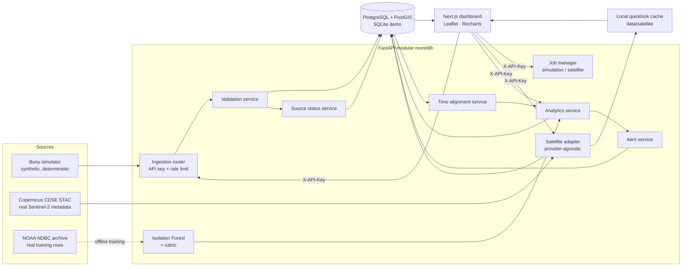
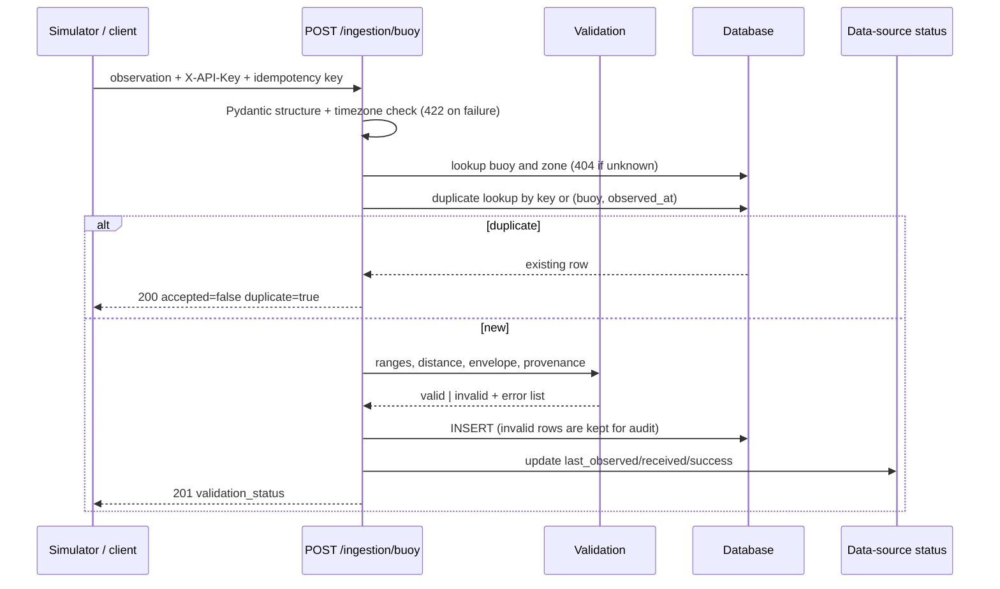
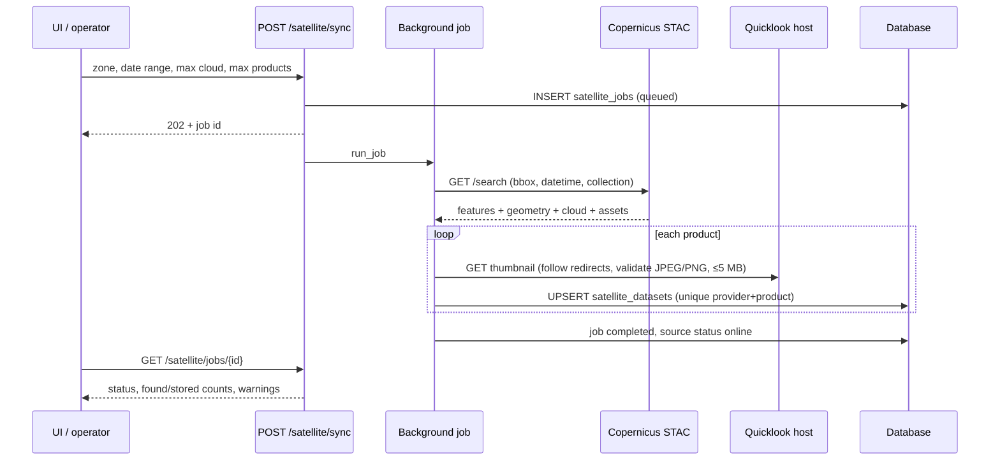
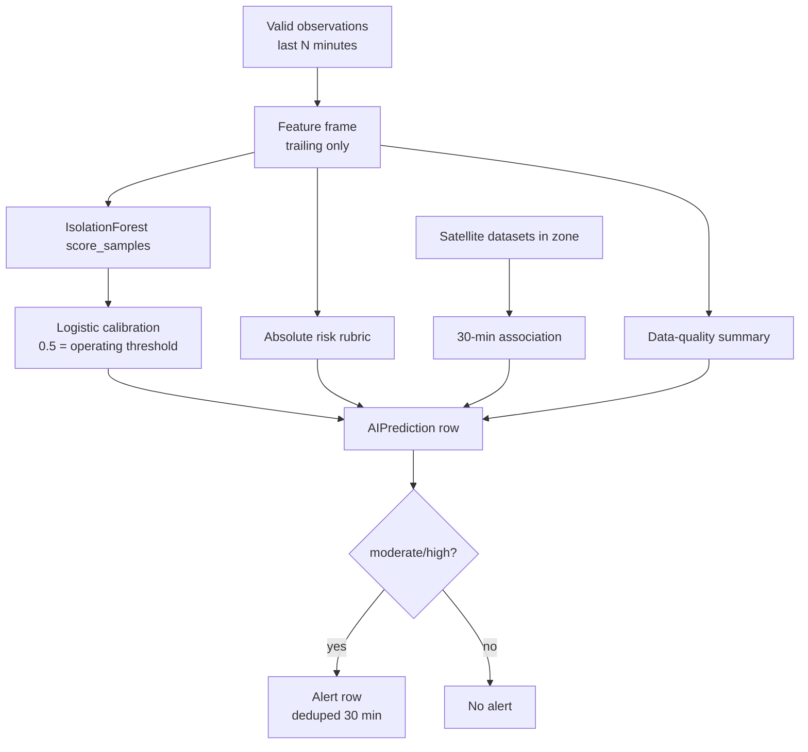
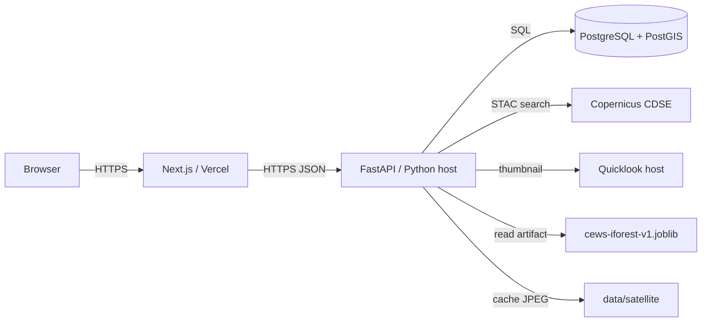

# Architecture

CEWS is a modular monolith: one FastAPI backend, one Next.js frontend, one relational database
(PostgreSQL/PostGIS in production, SQLite for the demo) and one model artifact. There are no
microservices.

## 1. Components

### Layers

| Layer | Module | Responsibility |
| --- | --- | --- |
| Source | `app/services/simulator.py` | Coherent synthetic series, scenario profiles, burst + interval modes, deterministic seeds |
| Source | `app/services/satellite/` | Provider protocol, Copernicus STAC adapter, thumbnail caching, fallback |
| Integration | `app/services/ingestion.py` | Single ingestion path used by API, simulator and seed |
| Integration | `app/services/validation.py` | Plausibility, timezone, position, provenance, duplicates |
| Integration | `app/services/time_sync.py` | 30-min association, quality summary |
| Analytics | `app/ml/` | Features, calibration, threshold, scoring, rubric |
| Analytics | `app/services/analytics.py` | Window selection, persistence, explanation, alert creation |
| Application | `app/api/v1/routers/` | Public reads, privileged writes, OpenAPI |
| Application | `frontend/` | Dashboard app shell (sidebar, status bar) + six workspaces reading from the API |

## 2. Ingestion sequence

## 3. Satellite acquisition

If the provider is unavailable the job ends `completed_with_fallback`, the source becomes
`unavailable` and cached datasets stay visible unchanged. Buoy monitoring and analytics do not
depend on satellite availability.

## 4. AI analysis

## 5. Key design decisions

1. **Provenance in the schema, not in prose.** `source_type`, `validation_status`,
   `validation_errors`, `simulation_id`, `idempotency_key`, acquisition timestamps and attribution
   are stored per row and surfaced in the UI.
2. **Separate clocks.** `observed_at`, `received_at`, `processed_at` are never conflated.
3. **Invalid ≠ deleted.** Out-of-range rows are stored with `validation_status="invalid"` and
   excluded from charts/analytics.
4. **Cadence-aware features.** The model must transfer from 10-minute NDBC cadence to 1–10-minute
   simulation. Relative deviations and per-hour rates replace raw sample-to-sample statistics.
5. **Calibration is explicit.** The operating threshold is fitted on documented normal-scenario
   windows; the calibration metadata travels with the artifact and is shown in the UI.
6. **Model ≠ risk.** The anomaly score measures unusual behaviour; the rubric grades absolute
   severity. Either can be inspected independently.
7. **Dialect-aware geometry.** `app/db/types.py` stores Shapely geometries as PostGIS
   POINT/POLYGON/MULTIPOLYGON on PostgreSQL and WKT text on SQLite, so one model layer serves both.
8. **Fail closed on writes.** Privileged endpoints require `X-API-Key`; with no key configured the
   API returns 503 rather than allowing anonymous writes.
9. **Bounded provider calls.** Timeouts, response-size limits, content-type checks and explicit
   error kinds (`timeout`, `network`, `http`, `malformed`) for actionable degradation.
10. **Demo coherence.** Manual scenario bursts replace earlier *synthetic* readings inside their
    replay window and record the replaced count in the job notes, so charts never mix two
    storylines. Real/observed rows are never touched by this rule.

## 6. Runtime topology

Local demo: `uvicorn` on :8000, `next dev` on :3000, SQLite at `data/cews.db`, cached quicklooks at
`data/satellite/`.

## 7. Security posture

- Secrets via environment variables only (`.env`, gitignored).
- Public demo key is intentional and documented; production rotates `API_SECRET_KEY` and disables
  `DEMO_MODE`.
- CORS restricted to configured origins; explicit methods and headers.
- Ingestion rate limiting (per-process sliding window) returns 429 with `Retry-After`.
- Thumbnail paths are resolved and confined to the cache directory before serving.
- Satellite credentials (`SATELLITE_CLIENT_ID/SECRET`) exist for future authenticated download but
  are unused and never sent to the browser.
- API responses never include provider credentials or local filesystem paths except the model
  artifact path in `/analytics/model-info` (administrative information).

## 8. Failure modes

| Failure | Behaviour |
| --- | --- |
| Provider timeout / 5xx / malformed JSON | Job failed or cached fallback; source `unavailable`; warning list |
| Thumbnail download fails | Dataset stored `metadata_only`; job still completes with warning |
| Model artifact missing/corrupt | `/analytics/run` returns 503; health shows `degraded` |
| Empty observation window | `/analytics/run` returns 422 with an instruction to generate data |
| Duplicate ingestion | 200 with `duplicate: true`, no second row |
| Invalid measurement | 201 with `validation_status: invalid`, kept for audit |
| Alert transition violation | 409 with the allowed lifecycle |
| Database unreachable | Health `degraded`; UI error states with retry |
